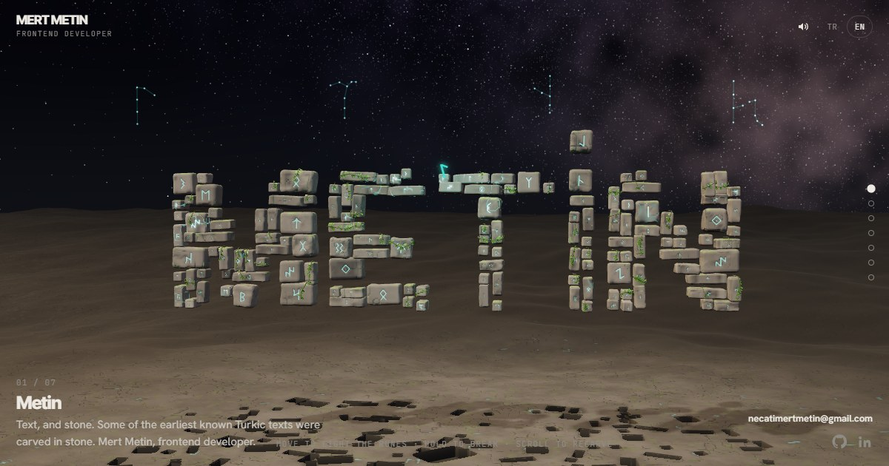

# 𐰢 Metin

**[necatimertmetin.github.io/metin](https://necatimertmetin.github.io/metin/)**

*Metin* hem bir isim, hem bir kelime: yazı. Bilinen ilk Türkçe metinlerden bazıları taşa kazındı.

Karanlıkta tek bir taş bekler. Ona dokununca kayaya çakılır; kaya çatlar, içinden rün işlenmiş taşlar kopup havalanır
ve bir araya gelip yazıyı kurar. Göğe bakınca dört takımyıldız Göktürk harfleriyle 𐱅𐰭𐰼𐰃 yazar: Teŋri, gök.
Basılı tutarsan taşlar yere düşer; bırakınca yeniden toplanırlar.

---

*Metin* is a name, and a word: text. Some of the earliest Turkic texts were carved in stone.

In the dark a single stone waits. Touch it and it strikes the rock; the rock cracks, and stones cut with runes break
free, rise and gather into words. Look up, and four constellations write 𐱅𐰭𐰼𐰃 in Old Turkic letters: Teŋri, the sky.
Hold, and the stones fall; let go, and they gather again.

— Mert Metin
